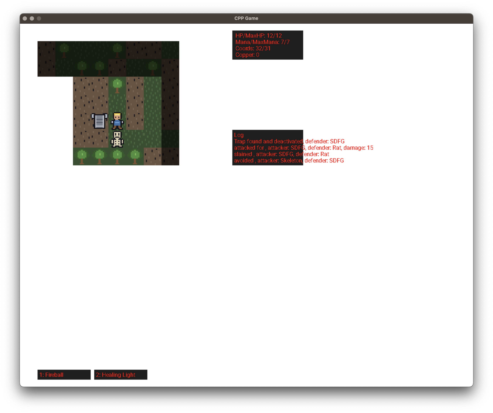

# cpp-game

[](https://github.com/danilkuzin/cpp-game/actions/workflows/cmake-linux.yml)

A roguelike with basic activities: explore the world, attack monsters, equip items, cast spells.
Single-player 2D game in C++23 and SDL3. Hobby and learning project.



## Build, Test and Run

Needs CMake 3.28+ and a C++23 compiler; SDL3, SDL_ttf, GoogleTest and nlohmann/json are fetched at
configure time.

Test
```bash
cmake --preset debug
cmake --build --preset debug
ctest --preset debug
python3 scripts/check_header_includes.py
```
Run
```bash
cmake --preset release
cmake --build --preset release
cd build-release/RelWithDebInfo && ./game
```

## Architecture

core -> domain(+ECS) -> Ui -> graphics(+SDL dependency) / game_states -> game

`Core`, `Domain` and `Ui` never include SDL, which keeps the rules and the presentation logic testable
without a window. CI enforces it.

## Licence

MIT, see `LICENSE`. SDL3 and SDL_ttf are zlib-licensed, GoogleTest is BSD-3-Clause, nlohmann/json is
MIT; none of them are vendored here. `assets/Roboto-Regular.ttf` is under the SIL Open Font License 1.1, see
`assets/Roboto-Regular.LICENSE.txt`.
